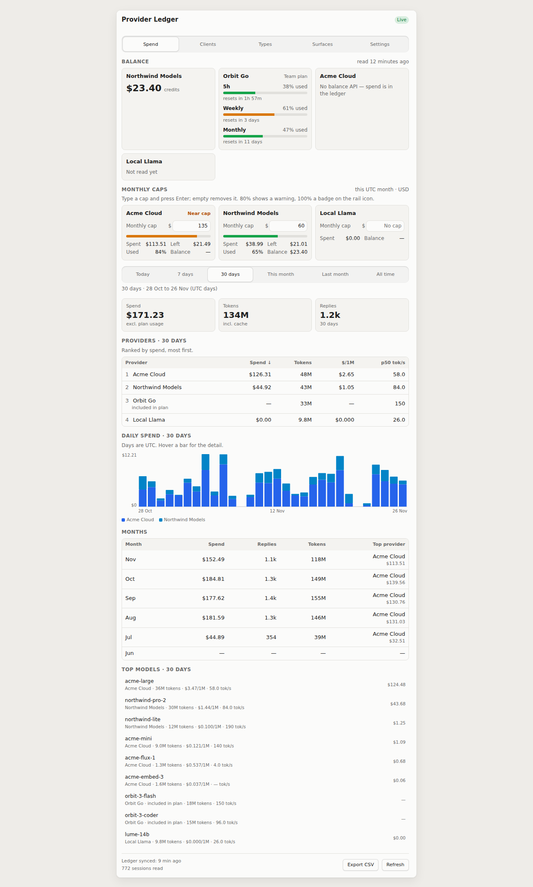
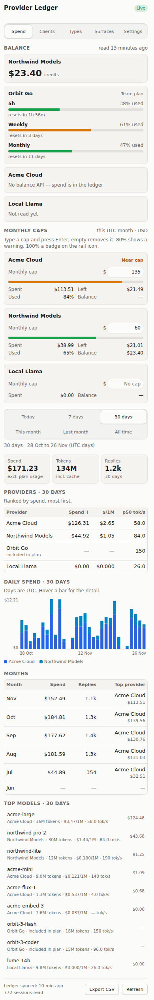
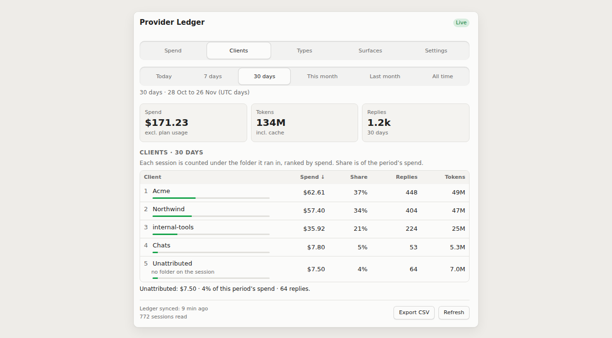
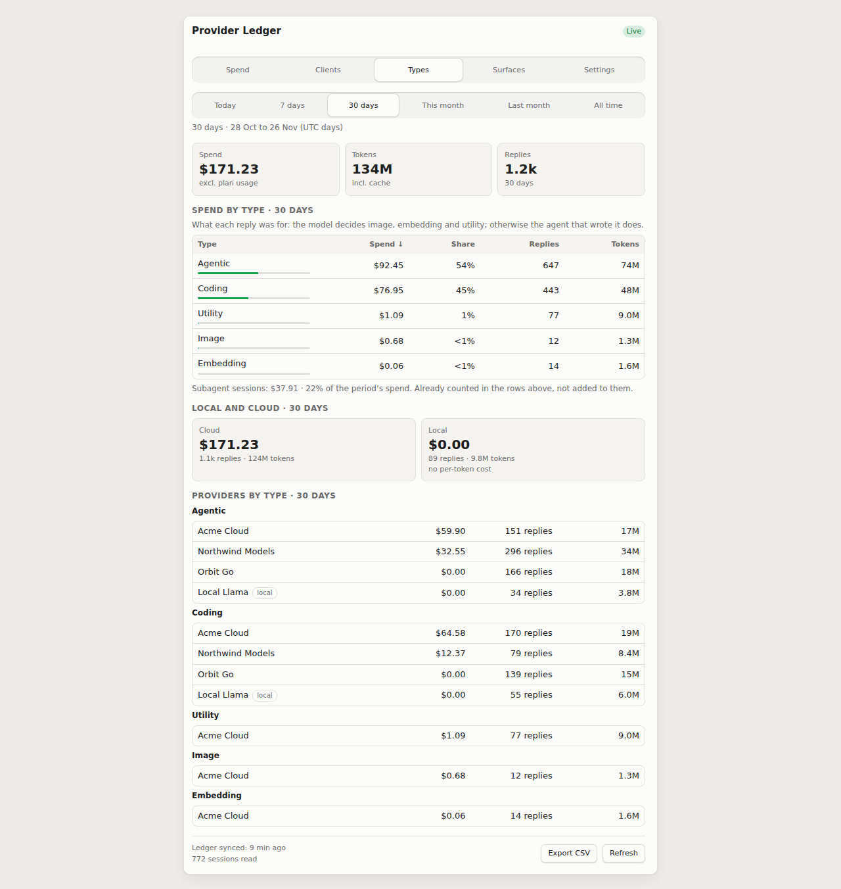
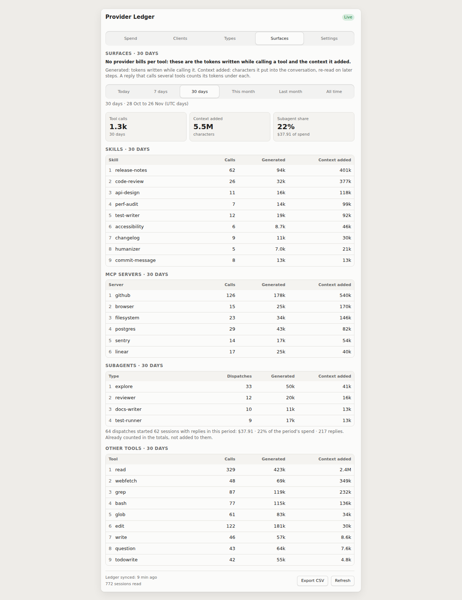
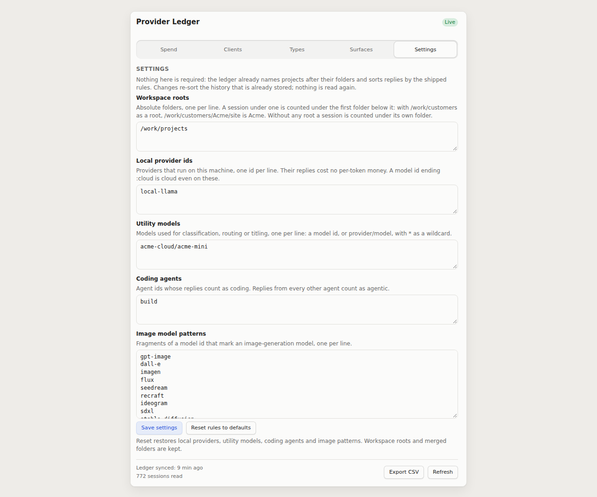

# Provider Ledger

An OpenChamber extension that answers five questions about the model providers you use: what each one cost, what the money was for, how fast it is, what is left on it, and **which part of your own setup is doing the spending** — the skills you load, the MCP servers you run, the subagents you dispatch. It reads OpenCode's own session history, keeps a small ledger of per-day, per-provider, per-model spend and speed on your machine, and reads provider balances when OpenChamber refreshes its Usage card. Nothing is configured to start with: install it, approve the two roles it asks for, and spend appears once the history has been read.

## What you see

It shows up in three places.

- **A rail panel** with five tabs, described below. A badge on the rail icon counts providers at or over their monthly cap.
- **A "Spend" section in Work Status**: a few rows for today, the week and the month, a balance bar per provider that has one, and a warning or error row for any provider near or over its cap.
- **A card on the Usage page** (`ext-provider-ledger`): spend for today, the week and the month, plus each provider's plan windows.

There is also an **agent tool**, `provider_ledger`, that lets an OpenCode agent ask the same questions in words (see below). The figures in every screenshot here are synthetic.

### Spend

Leads with provider balances and monthly caps, then a period picker, totals, a ranked provider table (spend, tokens, blended price per million tokens, median tokens per second), a daily or monthly chart, a six-month table and the top models.



It works at phone width too; wide tables drop the tokens column and the period picker wraps.



### Clients

Ranks projects by spend, each session counted under the folder it ran in, with a share of the period's spend and a one-line fix for a deep folder tree.



### Types

Splits spend by what it was for (coding, agentic, utility, image, embedding) and by local versus cloud, with the providers behind each type and the share that ran in subagent sessions.



### Surfaces

Which of your own skills, MCP servers, subagents and tools were called in the period, how many tokens were written while calling each, and how much text each put into the conversation. See [What Surfaces measures](#what-surfaces-measures) for what is and is not measured.



### Settings

The rules behind Clients and Types: workspace roots, local providers, utility models, coding agents and image patterns.



## Roles it asks for, and why

The extension runs a small service on your machine and declares two roles. OpenChamber shows both when you install and asks you to approve them.

- **`opencode`** lets the service read OpenCode's session list and each session's messages, read-only, through the connection OpenChamber already holds. This is how spend is known at all. From each reply it uses the provider, model, cost, token counts, timestamps, the agent in force, the folder the session ran in, whether the session was started by another one, and the name of each tool the reply called with the length of what it returned (a skill's or subagent's name is read from the call's input too). OpenCode hands back message bodies alongside those fields; the ledger neither stores nor uses them.
- **`quota`** lets the service receive the credentials OpenCode already holds for the providers listed under *Supported providers*, so it can ask each provider's own balance endpoint what is left. It is used for nothing else. It reads no conversation content, and it does not need one: a balance read is a request to the provider's billing or usage endpoint, made with the key you already use.

The ledger never sends a prompt or a message to any model or provider. Its only outbound requests are those balance and usage reads, made from your machine to the provider. Nothing is sent to the extension's author or any third party.

## Where your data lives

One file, outside the extension's folder (a write inside it would reload the extension): `~/.local/share/openchamber-provider-ledger/store.json`, mode `0600`, written atomically. Set `PROVIDER_LEDGER_STORE` to put it somewhere else. It holds daily buckets, not messages, for up to three years, and is kept under 16 MB by dropping the oldest days first. It also holds the latest balance readings, your monthly caps and your settings. Each session's folder is kept too, so a change of workspace roots can re-sort history without reading it again. Deleting the file is safe: the history is read again, though your caps and settings go with it.

Tool calls (the Surfaces tab) live in a second section of the same file, keyed by session, with a marker saying when each session was last read for them. It is filled in **newest first**, sessions touched in the last 30 days before older history, so the tab has something to show within a minute or two while the rest is read behind it. A session that has not changed since it was read is skipped, and the buckets above are never touched by it. The result text of a tool is measured and thrown away: only its length is kept.

A session you have never opened is read whatever its age, 40 sessions per run, oldest first, so a large history takes a few minutes the first time; the panel says "Re-reading history" and that figures are partial until it finishes.

## Periods

Today, 7 days, 30 days, This month, Last month and All time (since the first day the ledger holds). All days and months are **UTC**. A provider whose replies all cost nothing while it reports plan windows is shown as *included in plan*, never as `$0.00`.

## Balances

Each provider with a reader shows money left, plan windows (5 hour, weekly, monthly) with their reset time, or, when it has no balance API, just its ledger spend. A failed or expired read says what failed (an expired Console sign-in reads "Sign in again") and is never drawn as a zero balance. Readings are taken **when OpenChamber refreshes its Usage card** and cached, so the panel says how long ago each was read; opening the panel does not refresh them.

## Clients and workspace roots

Every bucket carries a project key taken from the folder the session ran in.

- **By default the key is the folder's own name.** That is right for a repository, a vault and a project folder alike, with no setup.
- **Workspace roots** (Settings): a list of absolute folders. A session under a root is counted under the first folder below it, whatever sits deeper. With `/work/customers` as a root, `/work/customers/Acme/site/src` is `Acme`; without the root it is `src`. The deepest matching root wins. Changing the roots re-sorts what is stored at once.
- **OpenChamber's own chat folders** (`…/.config/openchamber/chats/…`) are all one key, `Chats`, because every chat has a folder of its own.
- A session with no folder is **`Unattributed`**, and the Clients tab always says how much that is.
- **Merge into parent:** a row that sits inside another folder offers "Merge into *folder*", so a deep tree does not become hundreds of one-reply rows. Merged folders are counted under the parent; *Settings → Merged folders* restores them. It is a view over the ledger: nothing stored is changed.

## Types

Each reply is given a **scope** and a **category**, worked out when you look rather than when it was recorded, so editing a rule re-sorts all history immediately.

- **Scope.** `local` when the provider is a local runtime (`ollama`, `lmstudio`, `llamacpp`, `vllm`, `llama.cpp` by default), `cloud` otherwise. A model id ending `:cloud` is `cloud` even on a local runtime, which is how Ollama's hosted models read.
- **Category**, tried in this order: **image** (model id contains `gpt-image`, `dall-e`, `imagen`, `flux`, `seedream`, `recraft`, `ideogram`, `sdxl` or `stable-diffusion`), **embedding** (an embedding model), **utility** (a model you list as classification, routing or titling), then by the agent that wrote the reply: **agentic** for an agent that is not a coding agent, **coding** for one that is (`build` by default). **Uncategorised** when the agent cannot be known. A wrong label is worse than none, so nothing is guessed.
- **Which agent.** The message stream carries `agent-switched` entries, so one session can split between coding and agentic. A reply that names its own agent keeps it; otherwise the last switch before it applies; a session with no switch at all takes the session's own agent. A reply before the first switch of a session that has one has no known agent.

The **Types** tab shows spend by category for the period (with how much is uncategorised), a local-versus-cloud split where local is counted in replies and tokens and is always `$0.00` because it has no per-token cost, and the providers behind each category.

Everything above is editable in **Settings**: workspace roots, local provider ids, utility models (a model id, `provider/model`, or a `*` wildcard), coding agents and image patterns. *Reset rules to defaults* restores the shipped values and keeps your roots and merged folders.

## What Surfaces measures

The question is "which part of my setup is spending the tokens?". No provider answers it, because none bills per tool, so the tab reports two things the message history does record, and says so at the top: **"No provider bills per tool: these are the tokens written while calling a tool and the context it added."**

- **Generated** is the tokens written while calling it: the output and reasoning tokens of the reply that issued the call. A reply that calls several different tools counts its tokens under each of them, so the column does not add up to a total; a reply that calls the same tool three times counts its tokens once.
- **Context added** is the characters the tool put into the conversation (the length of its result text), which the model re-reads on later steps. It is the number to watch for a heavy skill or a chatty MCP tool. It is a character count, not a token count and not a price, and a call that had not completed has none.

Every tool call is given a class and a name:

| Class | When | Shown under |
| --- | --- | --- |
| `skill:<name>` | OpenCode's `skill` tool, named by its input (`name`, or `id`) | Skills |
| `mcp:<server>` | a tool named `mcp_<server>_<tool>`; the server is the first segment after `mcp_` | MCP servers |
| `agent:<type>` | a subagent dispatch (`task` or `subagent`), named by `subagent_type` or `agent` | Subagents |
| `tool:<name>` | everything else, and any name that does not follow a convention above | Other tools |

A server is **never guessed**: a tool whose name does not follow `mcp_<server>_<tool>` is an ordinary tool. Skills, MCP servers and other tools show the top ten by context added; subagents show the dispatch count, the top types, and the **subagent share**: the spend of sessions OpenCode lists as having a parent session, as a share of the period's spend. That spend stays inside every total (it is the same money, not extra), so the share and the rest never add to more than the whole.

Not measured, on purpose: a per-MCP or per-skill price, any allocation of cached-input reads to a tool, and anything in a tool's output beyond its length.

## Monthly caps

Type a USD cap per provider in the panel (empty removes it). Spend is the current UTC month. At 80 % a provider gets a warning row in Work Status; at 100 % an error row and a count on the rail icon. Zero, negative, non-numeric and non-dollar values are refused with a reason.

## Export CSV

*Export CSV* writes `provider-ledger-<YYYY-MM-DD>.csv` (UTC date) to `~/Downloads`, or to your home folder when there is none, and shows the path. Columns: `date,provider,model,project,category,scope,replies,tokens_input,tokens_output,tokens_reasoning,cache_read,cache_write,usd`. The file is written on the machine that runs OpenChamber.

## Agent tool

`plugin/` is an OpenCode plugin the extension contributes. It registers `provider_ledger { period?, provider? }`: spend for the period, the top three providers, a Surfaces line (the top three skills and MCP servers by context added, and the subagent share of spend) and, for the named provider (or every one with a cap or a balance), its windows and cap state. It is read-only, never throws into a session and imports nothing from the extension.

## Install

In OpenChamber, open **Settings → Extensions**, find *Provider Ledger* in the directory (category **Usage**) and install it, or install from this repository's URL, <https://github.com/Direct-Launch/openchamber-provider-ledger>. Approve the `opencode` and `quota` roles and allow the local service. Open the panel from the rail.

## Develop

```sh
bun install
bun test                          # fixtures only, no network
bun x tsc --noEmit
bun run build                     # panel/main.js and service/main.js
bun x openchamber-guest-check ./
```

`panel/main.js` and `service/main.js` are built output and are checked in: OpenChamber never compiles TypeScript. CI runs install, tests and the guest check on every push and pull request.

| Folder | What it is |
| --- | --- |
| `panel/` | the rail panel (sandboxed frame; talks only to the service) |
| `service/` | the local service: sync, ledger, balances, settings, export |
| `shared/` | types and formatting shared by both |
| `plugin/` | the OpenCode agent tool |
| `test/` | `bun test` suites |

## Supported providers

A provider shows a balance only when this extension ships a reader for it:

| Provider | Ids | What is read |
| --- | --- | --- |
| OpenCode Go and Zen | `opencode-go`, `opencode` | plan windows or credit balance (an API key, or the OpenCode Console sign-in) |
| Ollama Cloud | `ollama-cloud`, `console-ollama-cloud`, `ollama` | balance and the last seven days by model (the three ids are one account) |
| DeepSeek | `deepseek` | balance |
| Anthropic | `anthropic` | no balance API: ledger spend only |

Spend, speed and types are recorded for **every** provider OpenCode talks to, supported or not.

## Known limits

- **VS Code loads no extensions.** None of the surfaces above appear inside OpenChamber's VS Code integration.
- **Balances refresh only when OpenChamber refreshes its Usage card.** Opening the panel shows the last reading and its age; it does not fetch a new one.
- **Local models cost no per-token money.** They are counted in replies and tokens and shown as `$0.00`; electricity and hardware are not modelled.
- **The provider list is a manifest declaration approved at install.** An extension cannot read "whatever you have configured": only the providers named in the manifest are handed over, so a provider without a reader has no balance row until a release adds one.
- **Days and months are UTC**, not local time, so "Today" can differ from your calendar near midnight.
- **Agent attribution depends on what OpenCode records.** Replies whose agent cannot be read are shown as uncategorised.
- **Tool attribution is only as specific as the tool's name.** An MCP server is recognised from the `mcp_<server>_<tool>` convention. If your setup reaches its MCP servers through a wrapper tool (a "code mode" `execute` tool, say), every call to them is one ordinary tool, and the ledger does not look inside the code it runs to guess a server.
- **The subagent share needs the session listing to name a parent.** A session whose listing carries none is not guessed to be a subagent.
- **Tool calls fill in after the first sync, newest first.** Until the older sessions have been read, longer periods on the Surfaces tab are partial, and the tab says how many sessions are left.

## Licence

MIT. See `LICENSE`.
